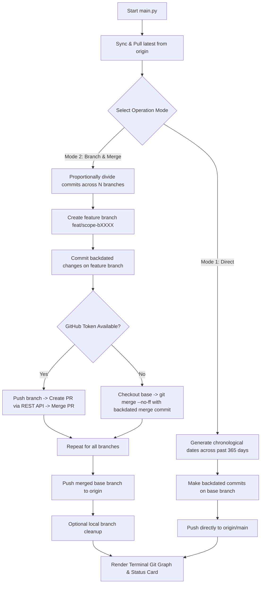

# 🌱 GitSprout — GitHub Activity Engine & Graph Greener

<p align="center">
  
  
  
  
  
</p>

<p align="center">
  <b>Automate backdated Git commits, proportional feature branches, pull requests, and merges from an interactive terminal UI.</b><br>
  Designed for Git workflow experimentation, repository testing, and turning your contribution heatmap vibrant green! 🟩🟩🟩
</p>

---

## 📖 Table of Contents

- [Overview](#overview)
- [Features](#features)
- [How It Works](#how-it-works)
  - [Workflow Logic (Mermaid)](#workflow-logic)
  - [Branch & Merge Architecture](#branch--merge-architecture)
- [Prerequisites](#prerequisites)
- [Quick Start Guide](#quick-start-guide)
- [GitHub Profile Setup (Turn Squares Green)](#github-profile-setup-turn-squares-green)
- [Operation Modes](#operation-modes)
  - [Mode 1: Direct Commit Mode](#mode-1--direct-commit-mode)
  - [Mode 2: Proportional Branch & Merge Mode](#mode-2--proportional-branch--merge-mode)
- [Interactive Terminal Preview](#interactive-terminal-preview)
- [Conventional Commit Messages](#conventional-commit-messages)
- [Optional: Online GitHub PR Integration](#optional-online-github-pr-integration)
- [Troubleshooting & FAQs](#troubleshooting--faqs)
- [Limitations & Operational Safety](#limitations--operational-safety)
- [Roadmap](#roadmap)
- [License](#license)

---

## ⚡ Overview

**GitSprout** (also known as _Graph-Greener_) is a pure Python automation engine that generates realistic Git activity and backdated commits across the previous 365 days.

Whether you want to backfill your contribution heatmap, simulate active Git collaboration workflows with feature branches and pull requests, or test repository analytics and CI pipelines, GitSprout handles the complete lifecycle automatically:

1. **Calculates Historical Timestamps:** Generates chronological dates within the last year and assigns them to `GIT_AUTHOR_DATE` and `GIT_COMMITTER_DATE`.
2. **Generates Conventional Commits:** Produces human-like commit messages adhering to Conventional Commits standards.
3. **Proportional Feature Branching:** Distributes commits evenly across multiple branches and integrates them via `--no-ff` merge nodes.
4. **GitHub REST API PR Engine:** Optionally creates and merges real Pull Requests online through GitHub's API.
5. **Zero External Dependencies:** Built 100% on Python standard library modules (`subprocess`, `urllib`, `random`, `datetime`, `json`). No `pip install` required!

---

## ✨ Features

| Feature                         | Description                                                                             |
| ------------------------------- | --------------------------------------------------------------------------------------- |
| 🟩 **Green Contribution Graph** | Fills your GitHub profile heatmap with backdated commits scattered across the past year |
| 🌿 **Proportional Branching**   | Specify total commits and branch count; the engine divides them evenly across branches  |
| 🔀 **Pull Request Automation**  | Automatically creates and merges real Pull Requests using the GitHub REST API           |
| ⚡ **Local Merge Fallback**     | Creates clean non-fast-forward (`--no-ff`) merge commits when token/API is not used     |
| 📝 **Conventional Commits**     | Realistic commit messages (`feat`, `fix`, `refactor`, `perf`, `docs`, `style`, `chore`) |
| 📅 **Historical Timestamps**    | Chronologically ordered random timestamps across the preceding 365 days                 |
| 🔄 **Safe Remote Sync**         | Automatically pulls latest remote updates before starting to prevent push rejections    |
| 📊 **Git Graph Visualizer**     | Renders an ASCII commit tree (`git log --graph`) directly in your console               |
| 🧹 **Branch Cleanup**           | Prompted option to delete temporary local feature branches after completion             |
| 🎨 **Neon Cyberpunk CLI**       | Live progress bars, ASCII telemetry cards, and formatted execution reports              |

---

## 🧠 How It Works

### Workflow Logic



### Branch & Merge Architecture

```text
                        main
                         │
        ┌─────┴─────┐
        │                               │
   feat/core                  feat/auth
   ├── commit 1               ├── commit 1
   ├── commit 2               ├── commit 2
   └── commit 3               └── commit 3
        │                               │
        └─────┬─────┘
                         │
                 Merge Commits / PRs
                         │
                        main
                         │
        ┌─────┴───────┐
        │                                     │
   feat/api                          feat/storage
   ├── commit 4                       ├── commit 4
   └── commit 5                       └── commit 5
        │                                        │
        └─────┬────────┘
                         │
                 Merge Commits / PRs
                         │
                        main (pushed to origin)
```

---

## 📋 Prerequisites

Before running GitSprout, ensure you have:

- **Python 3.8+** installed (`python3 --version` or `python --version`)
- **Git** installed and available on your `PATH` (`git --version`)
- A **GitHub Account**
- A **GitHub Personal Access Token** _(optional, only needed for online PR creation)_

---

## 🚀 Quick Start Guide

The recommended and cleanest workflow is to use an isolated, dedicated private repository (e.g. `sprout-vault`). This keeps your existing production projects untouched.

### Step 1 — Create a Private Repository on GitHub

1. Open [GitHub — New Repository](https://github.com/new).
2. Set the repository name to **`sprout-vault`** (or any unique name you like).
3. Select **Private** 🔒.
4. _(Optional)_ Check **Add a README file**.
5. Click **Create repository**.

### Step 2 — Clone Your Repository Locally

In your terminal, clone your newly created repository:

```bash
git clone https://github.com/YOUR_USERNAME/sprout-vault.git
cd sprout-vault
```

_(Replace `YOUR_USERNAME` with your actual GitHub username)_

### Step 3 — Add `main.py` and `data.txt`

Copy [`main.py`](file:///Users/deadlium/codes/github/GitSprout/main.py) into your cloned `sprout-vault` folder:

```bash
# If GitSprout is cloned locally on your machine:
cp /path/to/GitSprout/main.py ./

# Create the activity file:
touch data.txt
```

_(Note: If `data.txt` does not exist yet, the script will automatically create it upon first commit)._

Your local folder will look like:

```text
sprout-vault/
├── .git/
├── README.md
├── data.txt
└── main.py
```

### Step 4 — Run GitSprout

Execute the script from inside your repository folder:

```bash
python3 main.py
```

### Step 5 — Follow On-Screen Prompts

1. **Choose Workflow:** Enter `1` for Direct Commits or `2` for Proportional Branch & Merge.
2. **Total Commits:** Enter the number of commits (e.g., `20` or `60`).
3. **Number of Branches:** _(Mode 2)_ Enter how many branches to distribute across (e.g., `4`).
4. **Target File:** Press Enter to keep default (`data.txt`).
5. **Commit Messages:** Press Enter for realistic automated messages, or `n` for custom.
6. **Watch the Process:** Commits, branches, and merges are executed and pushed to GitHub!

---

## 🟩 GitHub Profile Setup (Turn Squares Green)

If you used a **private** repository, GitHub hides private activity by default. To make your green squares appear on your public profile:

1. Go to your **GitHub Profile** (`https://github.com/YOUR_USERNAME`).
2. Scroll to your **Contribution Graph**.
3. In the top-right corner above the graph, click **Contribution settings**.
4. Check **Private contributions** ✅.

```text
Contribution settings ➔ [✓] Private contributions
```

> [!NOTE]
> **Email Verification:** GitHub only credits contributions if the commit author's email matches an email address registered in your GitHub account. Check your local Git email:
>
> ```bash
> git config user.email
> ```
>
> Ensure this email is verified under your [GitHub Email Settings](https://github.com/settings/emails).
>
> **Cache Delay:** GitHub caches profile graphs. It usually takes **2 to 10 minutes** after pushing for your heatmap to update.

---

## 🛠️ Operation Modes

### Mode 1 — Direct Commit Mode

- Commits directly onto the active branch (`main` or `master`) and pushes to `origin`.
- Generates random timestamps over the last 365 days, sorted chronologically.
- Appends timestamped log lines to `data.txt` with conventional commit messages.
- **Best for:** Fast, simple, linear backdated commits.

### Mode 2 — Proportional Branch & Merge Mode

- Proportionally distributes your target commit count across feature branches (`feat/scope-bXXXX`).
- Creates each branch from the base, commits backdated changes, and merges back into the base.
- **Two Merging Strategies:**
  - **With GitHub Token:** Pushes branches, opens real Pull Requests via the GitHub REST API, and merges them online.
  - **Without Token (Local Merge):** Performs local non-fast-forward merges (`git merge --no-ff`) with backdated merge commits.
- **Activity Boost:** Generates both individual commits AND merge commits, giving you an authentic Git collaboration graph!

#### Proportional Distribution Formula

For $C$ total commits and $B$ branches:

- Base commits per branch: $\lfloor C / B \rfloor$
- Remainder commits distributed one-by-one to early branches: $C \pmod B$

| Total Commits | Branches |         Distribution Plan          | Merge Commits | Total Activity Nodes |
| :-----------: | :------: | :--------------------------------: | :-----------: | :------------------: |
|    **10**     |    3     |            `[4, 3, 3]`             |       3       |        **13**        |
|    **20**     |    4     |           `[5, 5, 5, 5]`           |       4       |        **24**        |
|    **50**     |    5     |       `[10, 10, 10, 10, 10]`       |       5       |        **55**        |
|    **100**    |    8     | `[13, 13, 13, 13, 12, 12, 12, 12]` |       8       |       **108**        |

---

## 💻 Interactive Terminal Preview

```text
  ██████╗ ██████╗  █████╗ ██████╗ ██╗  ██╗
 ██╔════╝ ██╔══██╗██╔══██╗██╔══██╗██║  ██║
 ██║  ███╗██████╔╝███████║██████╔╝███████║
 ██║   ██║██╔══██╗██╔══██║██╔═══╝ ██╔══██║
 ╚██████╔╝██║  ██║██║  ██║██║     ██║  ██║
  ╚═════╝ ╚═╝  ╚═╝╚═╝  ╚═╝╚═╝     ╚═╝  ╚═╝
   ⚡ G I T H U B   A C T I V I T Y   E N G I N E ⚡
   Automated Commits • Proportional Branching • PRs • Heatmap

 System Telemetry
  Repository:     . (your_user/sprout-vault)
  Active Branch:  main
  Remote Origin:  Configured

[SYNC] Checking remote updates...
  ✔ Pull complete (Already up to date.)

[MODE] Select Operation Workflow:
  [1] Direct Commit Mode          ─ Direct linear commits on 'main' & push
  [2] Proportional Branch Mode    ─ Custom commits & branches (proportionally divided!) 🚀

  Enter mode choice [1/2] (default 2): 2

[PARAMS] Workflow Configuration:
  How many total commits to generate? (default 20): 20
  How many branches to distribute commits across? (default 4): 4
  ↳ Plan: 20 commits divided across 4 branches: [5, 5, 5, 5] commits/branch
  Target file to modify (default data.txt):
  Use realistic automated commit messages? (Y/n, default Y): Y

[RUN] Processing 4 branches & 20 commits...
  ⠋ Commits [████████████████████████████] 100.0% (20/20) feat/api-b1024-4 [20/20]
  ✔ Pushed merged main to origin/main

  Clean up local feature branches? (Y/n, default Y): Y
  ✔ Cleaned up 4 local feature branches.

━━━ GIT GRAPH VISUALIZER (RECENT COMMITS) ━━━━━━━━━━━━━━━━━━━
*   7f92a10 Merge pull request #342 from feat/api-b1024-4
|\
| * a1b2c3d feat(api): implement asynchronous request pipeline
| * d4e5f6g fix(auth): enhance error recovery mechanism
* | 8a9b0c1 Merge pull request #341 from feat/storage-b1024-3
...

   Status Report
  Mode:            PROPORTIONAL BRANCH & MERGE
  Base Branch:     main
  Branches Made:   4
  Feature Commits: 20
  Merge Commits:   4
  Total Activity:  24 total commits added
  Target File:     data.txt
  Contribution:    Synced with GitHub Activity & Graph! 🌟
```

---

## 📝 Conventional Commit Messages

GitSprout generates industry-standard Conventional Commits:

```text
feat(core): implement asynchronous request pipeline
fix(auth): enhance error recovery mechanism
refactor(api): streamline state reconciliation logic
perf(storage): optimize memory buffer allocation
docs(config): update dependency security audit rules
chore(worker): align internal telemetry events format
```

Supported commit types:

| Type       | Description                                   |
| ---------- | --------------------------------------------- |
| `feat`     | New features or functional additions          |
| `fix`      | Bug fixes and patches                         |
| `refactor` | Code restructuring without behavioral changes |
| `perf`     | Performance optimizations                     |
| `docs`     | Documentation and metadata updates            |
| `style`    | Formatting, whitespace, and linting           |
| `chore`    | Routine maintenance and configuration tasks   |

Scopes include: `core`, `auth`, `api`, `ui`, `config`, `engine`, `utils`, `storage`, and `worker`.

---

## 🔑 Optional: Online GitHub PR Integration

To have real Pull Requests created and merged in your online GitHub repository:

1. Create a **Personal Access Token** at [GitHub Settings ➔ Personal Access Tokens](https://github.com/settings/tokens).
2. Ensure it has the `repo` permission scope.
3. Export it in your environment:
   ```bash
   export GITHUB_TOKEN="ghp_yourTokenHere123456789"
   ```
4. Or enter it interactively when prompted by the script.

_If no token is supplied, GitSprout smoothly falls back to local `--no-ff` merge commits without interrupting execution._

---

## ❓ Troubleshooting & FAQs

### 1. Commits are pushed, but my GitHub graph isn't turning green!

- **Private Contributions Disabled:** Check **Contribution settings ➔ Private contributions** on your GitHub profile.
- **Email Mismatch:** GitHub requires the commit author email to match an email registered to your GitHub account:
  ```bash
  git config user.email
  ```
  Verify it in your [GitHub Email Settings](https://github.com/settings/emails).
- **Default Branch:** Commits must be on the repository's default branch (`main` or `master`). GitSprout pushes to your active branch automatically.
- **GitHub Cache:** Contribution heatmaps take **2 to 10 minutes** to refresh. Hard-refresh the page (`Ctrl + Shift + R` or `Cmd + Shift + R`).

### 2. "Git error: fatal: not a git repository"

Run the script inside a cloned Git repository directory, or initialize one first:

```bash
git init
git remote add origin https://github.com/YOUR_USERNAME/sprout-vault.git
```

### 3. "fatal: The current branch main has no upstream branch"

Push an initial commit so Git tracks the upstream branch:

```bash
git branch -M main
git push -u origin main
```

---

## ⚠️ Limitations & Operational Safety

- **Isolated Repositories:** Always run GitSprout inside a dedicated, isolated test repository (like `sprout-vault`). Never run it in team or production repositories.
- **Ethical Usage:** Backdated commit generation is meant for repository testing, migration experiments, Git learning, and personal aesthetic profile customization. Do not use generated history to misrepresent professional experience.
- **No Automatic Rollback:** Interrupted runs leave commits intact. Inspect your Git status before restarting:
  ```bash
  git status
  git log --oneline --graph -10
  ```

---

## 🗺️ Roadmap

- [x] Direct backdated commit generation
- [x] Proportional feature branch distribution
- [x] GitHub REST API pull request and merge engine
- [x] Local `--no-ff` merge commit fallback
- [x] Conventional Commit message generator
- [x] Terminal progress visualization & ASCII telemetry
- [x] Git graph visualizer (`git log --graph`)
- [x] Automatic local branch cleanup
- [ ] Dry-run preview mode
- [ ] Configurable historical date windows (e.g. past 30 days, 6 months)
- [ ] Command-line argument flags (`--commits`, `--branches`, `--mode`)
- [ ] Package as a standalone CLI (`pipx install gitsprout`)

---

## 📄 License

This project is licensed under the [MIT License](file:///Users/deadlium/codes/github/GitSprout/LICENSE).

<p align="center">
  <b>Built with ❤️ for Git enthusiasts • Star ⭐ GitSprout if it helped green your graph!</b>
</p>
